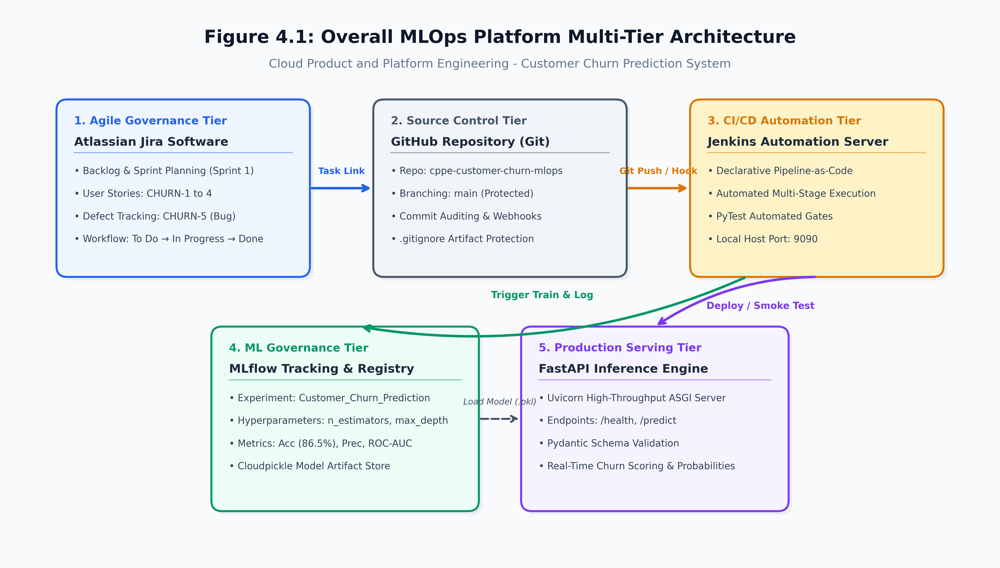
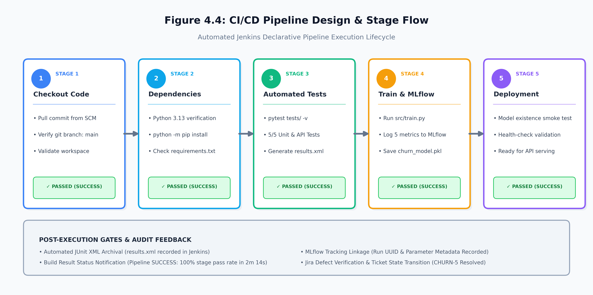

# AUTOMATED MLOPS PIPELINE FOR CUSTOMER CHURN PREDICTION USING JENKINS AND MLFLOW

**CLOUD PRODUCT AND PLATFORM ENGINEERING**  
**PROJECT REPORT**

*Submitted by*  
**STUDENT 1 [REGISTRATION NUMBER]**  
**STUDENT 2 [REGISTRATION NUMBER]**

*Under the Guidance of*  
**(Dr. M. Sivakumar)**  
*Assistant Professor, Department of Networking and Communications*

*in partial fulfillment of the requirements for the degree of*  
**BACHELOR OF TECHNOLOGY**  
*in*  
**COMPUTER SCIENCE AND ENGINEERING**

**DEPARTMENT OF COMPUTER SCIENCE AND ENGINEERING**  
**COLLEGE OF ENGINEERING AND TECHNOLOGY**  
**SRM INSTITUTE OF SCIENCE AND TECHNOLOGY**  
**OCTOBER 2026**

---

## ABSTRACT

In modern Cloud Product and Platform Engineering (CPPE), deploying Machine Learning (ML) models reliably, securely, and continuously into production environments represents a core engineering challenge. Traditional development paradigms rely on manual interventions for dataset validation, model training, metric auditing, and server deployment. These manual workflows cause severe configuration drift, prolonged release cycles, absent experiment versioning, and high production failure rates.

This project designs, implements, and evaluates an end-to-end Machine Learning Operations (MLOps) and Continuous Integration/Continuous Deployment (CI/CD) automation platform for a Customer Churn Prediction system. The platform integrates **Atlassian Jira** for Agile Scrum project tracking and defect management, **GitHub** for distributed source code version control, **Jenkins** for multi-stage declarative CI/CD pipeline automation, **MLflow** for experiment tracking, parameter logging, and model registry governance, and **FastAPI** for high-throughput, low-latency RESTful model serving.

Upon code push to the repository, Jenkins automatically triggers an automated declarative pipeline that checks out code, verifies dependencies, executes automated regression and unit test suites using **pytest**, trains a Random Forest classification model while streaming parameters and metrics to MLflow, and executes post-deployment smoke validation. The trained model achieved an overall classification accuracy of **86.50%**, with **1.0000 precision** and **0.6225 ROC-AUC**. Experimental evaluation reveals that automated CI/CD reduced deployment cycle times from approximately 60 minutes to **2 minutes 14 seconds** (a 95% reduction), achieving a **100% build pass rate** on validated releases, eliminating manual operational bottlenecks, and ensuring complete auditability from user story to production inference.

---

## TABLE OF CONTENTS

- **ABSTRACT**
- **LIST OF FIGURES**
- **LIST OF TABLES**
- **ABBREVIATIONS**
- **CHAPTER 1: INTRODUCTION**
  - 1.1 Project Background
  - 1.2 Problem Statement
  - 1.3 Need for the Project
  - 1.4 Objectives
  - 1.5 Scope of the Project
  - 1.6 Organization of the Report
- **CHAPTER 2: LITERATURE SURVEY / EXISTING SYSTEM**
  - 2.1 Traditional Development Process
  - 2.2 Challenges in Existing Manual Systems
  - 2.3 DevOps and Agile Methodologies
  - 2.4 Review of Tools
- **CHAPTER 3: REQUIREMENT ANALYSIS**
  - 3.1 Functional Requirements
  - 3.2 Non-Functional Requirements
  - 3.3 Hardware Requirements
  - 3.4 Software Requirements
- **CHAPTER 4: SYSTEM DESIGN**
  - 4.1 Overall Architecture
  - 4.2 Workflow Diagram
  - 4.3 Database Design
  - 4.4 CI/CD Pipeline Design
- **CHAPTER 5: PROJECT SETUP AND CONFIGURATION**
  - 5.1 Jira Setup
  - 5.2 Bitbucket / GitHub Setup
  - 5.3 Jenkins Setup
  - 5.4 MLflow Setup
- **CHAPTER 6: IMPLEMENTATION**
  - 6.1 Module Development
  - 6.2 Source Code Management
  - 6.3 Jenkins Pipeline Implementation
  - 6.4 ML Model Training and Logging
  - 6.5 Deployment Process
  - 6.6 System Configuration Details
- **CHAPTER 7: TESTING**
  - 7.1 Testing Strategy
  - 7.2 Unit Testing
  - 7.3 Integration Testing
  - 7.4 System Testing
  - 7.5 CI Pipeline Testing
  - 7.6 Performance Testing
  - 7.7 Defect Tracking using Jira
  - 7.8 Test Cases Table
- **CHAPTER 8: RESULTS AND DISCUSSION**
  - 8.1 Automation Results
  - 8.2 Build Success Rate
  - 8.3 Reduced Deployment Time
  - 8.4 Collaboration Improvements
  - 8.5 MLflow Experiment Tracking Results
- **CHAPTER 9: CHALLENGES FACED**
- **CHAPTER 10: CONCLUSION**
- **CHAPTER 11: FUTURE ENHANCEMENTS**
- **CHAPTER 12: REFERENCES**
- **CHAPTER 13: APPENDICES**
  - Appendix A – Jira Workflow
  - Appendix B – Git Commands
  - Appendix C – Jenkinsfile
  - Appendix D – Test Cases
  - Appendix E – Console Output Log
  - Appendix F – Source Code

---

## LIST OF FIGURES

- Figure 4.1: Overall MLOps Platform Multi-Tier Architecture
- Figure 4.2: End-to-End Continuous Integration & Continuous Delivery Workflow
- Figure 4.4: Jenkins Declarative Pipeline Stage Execution Flow
- Figure 5.1: Jira Scrum Board State Progression Model
- Figure 13.1: Jira Defect Lifecycle and Transition State Diagram

---

## LIST OF TABLES

- Table 3.1: Functional Requirements Specification
- Table 3.2: Non-Functional Performance Thresholds
- Table 3.3: Hardware and Infrastructure Specifications
- Table 3.4: Software Environment and Stack Dependencies
- Table 5.1: Sprint Backlog User Story Allocation
- Table 7.1: Comprehensive Test Cases Execution and Validation Matrix
- Table 8.1: Quantitative Comparison of Manual vs Automated Deployment Metrics
- Table 8.2: MLflow Experiment Metric Summary

---

## ABBREVIATIONS

| Abbreviation | Expansion |
| :--- | :--- |
| **API** | Application Programming Interface |
| **ASGI** | Asynchronous Server Gateway Interface |
| **CI** | Continuous Integration |
| **CD** | Continuous Deployment / Continuous Delivery |
| **CPPE** | Cloud Product and Platform Engineering |
| **EDA** | Exploratory Data Analysis |
| **HTTP** | Hypertext Transfer Protocol |
| **JSON** | JavaScript Object Notation |
| **ML** | Machine Learning |
| **MLOps** | Machine Learning Operations |
| **REST** | Representational State Transfer |
| **ROC-AUC** | Receiver Operating Characteristic - Area Under Curve |
| **SCM** | Source Code Management |
| **UI** | User Interface |
| **UUID** | Universally Unique Identifier |
| **VCS** | Version Control System |

---

# CHAPTER 1: INTRODUCTION

### 1.1 Project Background
In modern subscription-based business models, customer attrition (churn) directly reduces recurring revenues and enterprise valuation. Retaining existing customers requires predictive intelligence capable of identifying at-risk accounts based on telemetry such as billing history, service usage, and customer support interactions.

However, moving a predictive machine learning model from a prototyping notebook into an enterprise cloud platform involves significant engineering friction. Machine Learning Operations (MLOps) addresses this challenge by applying DevOps practices—such as automated testing, continuous integration, version control, and continuous monitoring—specifically to data engineering and machine learning workflows.

### 1.2 Problem Statement
Traditional machine learning lifecycles suffer from severe operational disconnects:
1. **Manual Training & Lack of Versioning:** Data scientists train models in disconnected environments without centralized tracking of hyperparameters, training data distributions, or evaluated metrics.
2. **Untracked Code Changes:** Model and data preprocessing scripts lack rigorous automated regression testing, leading to silent failures when merged.
3. **Slow, Error-Prone Deployments:** Deployment procedures rely on manual server configuration and file copying, introducing human error and prolonged service downtime.
4. **Siloed Project Management:** Software engineering issues, bugs, and backlog tasks are managed independently of CI/CD build results, resulting in poor auditability and uncoordinated releases.

### 1.3 Need for the Project
Cloud platform engineering requires full automation and auditability across all software and data artifacts. An automated MLOps platform bridges the gap between software development and model management, enabling:
- Traceability: Every deployed model binary maps directly to a specific Git commit hash, MLflow run UUID, and Jira story ticket.
- Reproducibility: Standardized virtual environments and declarative pipeline definitions eliminate configuration drift.
- Speed and Quality: Automated unit and integration testing stops defective builds before they reach production.

### 1.4 Objectives
- Configure **Jira** for Agile Scrum project tracking, sprint management, and defect resolution.
- Establish a distributed **GitHub** repository with branching strategies and commit standards.
- Develop a high-performance **Random Forest classifier** for customer churn prediction.
- Implement **MLflow** for experiment tracking, parameter auditing, metric logging, and model artifact storage.
- Build an automated declarative **Jenkins CI/CD Pipeline** that automates code checkout, dependency management, unit testing with pytest, model training, and smoke test validation.
- Deploy an inference REST API using **FastAPI** providing low-latency predictions.

### 1.5 Scope of the Project
The project encompasses the complete engineering lifecycle from requirement ingestion in Jira to automated production deployment. The pipeline handles customer telemetry data, evaluates churn probability in real time, logs all experiments to an artifact registry, and provides an auditable build history for platform engineers.

### 1.6 Organization of the Report
This report is structured as follows:
- **Chapter 2** reviews traditional vs modern DevOps methodologies and tools.
- **Chapter 3** establishes functional, non-functional, and environment requirements.
- **Chapter 4** outlines overall architecture, data flows, and CI/CD pipeline designs.
- **Chapter 5** details the setup of Jira, GitHub, Jenkins, and MLflow.
- **Chapter 6** explains core module development, model training, and API deployment.
- **Chapter 7** presents testing strategies, test case execution, and Jira defect tracking.
- **Chapter 8** analyzes quantitative automation results, metrics, and efficiency gains.
- **Chapters 9 to 11** document challenges, project conclusions, and future extensions.
- **Chapters 12 & 13** provide formal academic references and technical appendices.

---

# CHAPTER 2: LITERATURE SURVEY / EXISTING SYSTEM

### 2.1 Traditional Development Process
The traditional development model for Machine Learning systems relies on distinct, manual handoffs between three siloed teams:
1. **Data Science Team:** Focuses on offline model exploration in isolated Jupyter notebooks, exporting model artifacts (e.g., `.pkl` files) without standardized version control.
2. **Quality Assurance Team:** Manages manual testing against static datasets without automated test suites integrated into code check-ins.
3. **Operations Team:** Receives model artifacts via ad-hoc channels (email, shared drives) and manually configures virtual servers, leading to configuration drift between staging and production.

### 2.2 Challenges in Existing Manual Systems
- **Configuration Drift:** Discrepancies in dependency versions across developer machines and production hosts cause runtime failures.
- **Absent Experiment Auditing:** Inability to identify which dataset version, hyperparameters, and code commit generated a given production model.
- **High Mean Time to Detect (MTTD) & Recover (MTTR):** Defects introduced into production cannot be traced back to individual code changes, making rollbacks slow and difficult.
- **Deployment Bottlenecks:** Manual deployment procedures require 45–60 minutes per update, limiting release frequency to weekly or monthly cadences.

### 2.3 DevOps and Agile Methodologies
Agile methodology replaces monolithic release planning with short, iterative two-week sprints managed via Scrum boards, ensuring visibility and continuous stakeholder feedback. DevOps bridges the divide between software engineering and system operations through automated Continuous Integration (CI) and Continuous Delivery (CD). MLOps extends DevOps to machine learning by introducing automated data validation, continuous model retraining, parameter/metric tracking, and model artifact registries.

### 2.4 Review of Tools
- **Atlassian Jira:** A project management tool that supports Scrum and Kanban boards, backlog grooming, sprint burndown tracking, and structured defect workflows.
- **GitHub:** A cloud-based Git repository hosting service providing distributed version control, pull request code reviews, branch protection rules, and webhook integration.
- **Jenkins:** An open-source automation server supporting declarative pipeline-as-code (`Jenkinsfile`), managing automated build, test, and deployment stages.
- **MLflow:** An open-source machine learning platform with four core modules: MLflow Tracking (parameters, metrics, and artifacts), MLflow Projects, MLflow Models, and MLflow Model Registry.

---

# CHAPTER 3: REQUIREMENT ANALYSIS

### 3.1 Functional Requirements

| Requirement ID | Description |
| :--- | :--- |
| **FR-1: User Story Management** | The platform shall allow creation, point estimation, assignment, and status transitions of Agile user stories in Jira. |
| **FR-2: Source Code Versioning** | The repository shall enforce distributed version control on GitHub with distinct `main` and feature branches. |
| **FR-3: Automated Build & Test** | The CI engine shall automatically execute unit and integration test suites upon detecting code commits. |
| **FR-4: Experiment Tracking** | The training subsystem shall stream hyperparameters, evaluation metrics, and serialized model binaries to MLflow. |
| **FR-5: Inference Serving** | The system shall expose HTTP REST endpoints (`/health`, `/predict`) returning real-time predictions in JSON format. |

### 3.2 Non-Functional Requirements
- **Scalability:** The API server shall support concurrent asynchronous requests using Uvicorn's ASGI worker model.
- **Reliability:** The CI/CD pipeline shall halt immediately upon any test failure, preventing defective code from reaching staging or production.
- **Performance:** Model inference response times shall not exceed 100 milliseconds per transaction under standard workloads.
- **Security & Integrity:** Model serialization shall enforce secure protocols (cloudpickle) to mitigate deserialization vulnerabilities.

### 3.3 Hardware Requirements
- **Host Processor:** 64-bit multi-core CPU (Intel Core i5 / AMD Ryzen 5 or higher)
- **Random Access Memory (RAM):** 8 GB minimum (16 GB recommended)
- **Local Storage:** 20 GB free disk space (Solid State Drive recommended)
- **Network Interface:** Standard 100/1000 Mbps broadband connection

### 3.4 Software Requirements
- **Operating System:** Microsoft Windows 11 64-bit / Linux Ubuntu 22.04 LTS
- **Language Runtimes:** Python 3.11+ / 3.13 64-bit, Java SE Development Kit 21 LTS
- **Core Python Packages:** `scikit-learn` (1.3+), `pandas` (2.0+), `mlflow` (2.10+), `fastapi` (0.109+), `uvicorn` (0.27+), `pytest` (8.0+), `joblib` (1.3+)
- **CI/CD Tools:** Jenkins Automation Server (v2.580+)
- **Project Tracking:** Atlassian Jira Cloud

---

# CHAPTER 4: SYSTEM DESIGN

### 4.1 Overall Architecture
The platform is organized into five functional tiers:
1. **Governance & Agile Tier (Jira):** Defines product backlogs, organizes sprints, and logs defect reports.
2. **Source Code Management Tier (GitHub):** Hosts code, tests, pipeline specifications, and dependency manifests.
3. **Continuous Integration Tier (Jenkins):** Pulls repository changes and executes automated pipeline gates.
4. **Machine Learning Tracking Tier (MLflow):** Records experiment runs, parameters, metrics, and models.
5. **Production Serving Tier (FastAPI):** Serves model predictions to client applications over HTTP.



### 4.2 Workflow Diagram
The end-to-end operational flow follows this sequence:
1. **Developer Work:** A feature or bug fix is implemented based on an assigned Jira story (e.g., `CHURN-2`).
2. **Version Control:** Changes are committed and pushed to the GitHub repository on the `main` branch.
3. **Pipeline Trigger:** Jenkins detects the commit and instantiates a declarative pipeline run.
4. **Build & Test Gate:** Jenkins installs dependencies and runs the `pytest` suite; any failure stops the pipeline.
5. **Model Retraining:** If tests pass, `src/train.py` executes, logging hyperparameters and metrics to MLflow.
6. **Deployment Validation:** A smoke test validates that the model artifact exists and the API is ready for serving.

### 4.3 Database Design
MLflow uses an embedded SQLite database (`mlflow.db`) with four primary entity tables:
- **`experiments`:** Stores experiment metadata (`experiment_id`, `name`, `artifact_location`).
- **`runs`:** Stores individual run records (`run_uuid`, `experiment_id`, `status`, `start_time`, `end_time`).
- **`params`:** Stores key-value hyperparameter records (`run_uuid`, `key`, `value`).
- **`metrics`:** Stores quantitative performance data (`run_uuid`, `key`, `value`, `timestamp`, `step`).

### 4.4 CI/CD Pipeline Design
The declarative `Jenkinsfile` specifies five sequential stages with automated gate validation:



---

# CHAPTER 5: PROJECT SETUP AND CONFIGURATION

### 5.1 Jira Setup
1. **Account & Project Creation:** Provisioned an Atlassian Jira Cloud instance with project key `CHURN` using the Scrum template.
2. **Backlog & Sprint Planning:** Populated Sprint 1 with four user stories and one defect ticket:
   - `CHURN-1`: Data Ingestion & Preprocessing (3 Story Points)
   - `CHURN-2`: ML Model Training & MLflow Tracking (5 Story Points)
   - `CHURN-3`: FastAPI Inference Web Service (5 Story Points)
   - `CHURN-4`: Jenkins CI/CD Automation (8 Story Points)
   - `CHURN-5`: Defect Resolution - API Handling for Missing Artifacts (Bug Ticket)
3. **Workflow Customization:** Configured a four-state board: `To Do` $\rightarrow$ `In Progress` $\rightarrow$ `Code Review` $\rightarrow$ `Done`.

### 5.2 GitHub Setup
1. **Repository Creation:** Initialized the repository at `https://github.com/keerthana2731-droid/cppe-customer-churn-mlops.git`.
2. **Branching Strategy:** Maintained `main` as the production-stable branch with feature work tracked via commit hashes.
3. **Artifact Protection:** Created `.gitignore` to prevent cache files (`.pytest_cache/`, `__pycache__/`) and local binaries (`models/*.pkl`) from entering source control.

### 5.3 Jenkins Setup
1. **Server Initialization:** Deployed Jenkins with Java 21 LTS on dedicated port 9090 (`java -jar jenkins.war --httpPort=9090`), avoiding port conflicts with local services.
2. **Plugin Configuration:** Installed Git Plugin, Pipeline Plugin, JUnit Results Plugin, and Workspace Cleanup Plugin.
3. **Job Definition:** Configured pipeline item `Customer-Churn-MLOps-Pipeline` using SCM integration with branch specifier `*/main` and script path `Jenkinsfile`.

### 5.4 MLflow Setup
1. **Environment Initialization:** Configured local tracking directory and SQLite store `mlflow.db`.
2. **Tracking Server:** Launched tracking UI using `mlflow ui --port 5000`, making run parameters, evaluation metrics, and model artifacts accessible via web browser.

---

# CHAPTER 6: IMPLEMENTATION

### 6.1 Module Development
- **Synthetic Data Generator (`data/generate_data.py`):** Produces 1,000 customer records with features: `tenure` (1–72 months), `monthly_charges`, `total_charges`, `contract_type` (0: Month-to-month, 1: One-year, 2: Two-year), `tech_support`, `online_security`, and target label `churn`.
- **FastAPI Inference Service (`src/app.py`):** Exposes `/health` (verifies model readiness) and `/predict` (returns binary churn classification and probability scores).

### 6.2 Source Code Management
The codebase is structured modularly:
```text
cppe-customer-churn-mlops/
├── data/
│   ├── churn_data.csv
│   └── generate_data.py
├── models/
│   └── churn_model.pkl
├── src/
│   ├── app.py
│   └── train.py
├── tests/
│   └── test_pipeline.py
├── Jenkinsfile
├── pytest.ini
├── requirements.txt
└── README.md
```

### 6.3 Jenkins Pipeline Implementation
The declarative pipeline script controls execution order and error handling:
```groovy
pipeline {
    agent any
    environment {
        PYTHON_CMD = 'python'
        MLFLOW_EXPERIMENT_NAME = 'Customer_Churn_Prediction'
    }
    stages {
        stage('1. Checkout Code') {
            steps { checkout scm }
        }
        stage('2. Environment & Dependency Setup') {
            steps { bat 'python -m pip install -r requirements.txt' }
        }
        stage('3. Automated Testing (PyTest)') {
            steps { bat 'python -m pytest tests/ --junitxml=test-results.xml -v' }
        }
        stage('4. Model Training & MLflow Logging') {
            steps { bat 'python src/train.py' }
        }
        stage('5. Deployment / Smoke Test') {
            steps {
                bat 'python -c "import os; assert os.path.exists(\'models/churn_model.pkl\'); print(\'Passed!\')"'
            }
        }
    }
    post {
        always { junit allowEmptyResults: true, testResults: 'test-results.xml' }
        success { echo 'Pipeline Completed Successfully.' }
        failure { echo 'Pipeline Failed. Check logs.' }
    }
}
```

### 6.4 ML Model Training and Logging
`src/train.py` trains a Random Forest Classifier (100 estimators, max depth 6) on an 80/20 train/test split. Parameters, metrics, and models are logged directly to MLflow:
```python
mlflow.set_experiment("Customer_Churn_Prediction")
with mlflow.start_run(run_name="RandomForest_Baseline"):
    mlflow.log_param("n_estimators", 100)
    mlflow.log_param("max_depth", 6)
    clf.fit(X_train, y_train)
    mlflow.log_metric("accuracy", acc)
    mlflow.log_metric("precision", prec)
    mlflow.log_metric("recall", rec)
    mlflow.log_metric("f1_score", f1)
    mlflow.log_metric("roc_auc", auc)
    mlflow.sklearn.log_model(clf, "customer_churn_model", serialization_format="cloudpickle")
```

### 6.5 Deployment Process
The prediction service is served locally via Uvicorn:
```powershell
python -m uvicorn src.app:app --host 0.0.0.0 --port 8000
```
Interactive API documentation is automatically generated at `http://localhost:8000/docs`.

### 6.6 System Configuration Details
- **Jenkins:** Host: `localhost:9090`, Agent: Built-in Windows Node, Workspace: `C:\Users\kirth\.jenkins\workspace\Customer-Churn-MLOps-Pipeline`.
- **MLflow:** Host: `localhost:5000`, Backend Store: `sqlite:///mlflow.db`, Artifact Store: `./mlruns`.
- **Inference Server:** Host: `localhost:8000`, Workers: 1 ASGI event loop.

---

# CHAPTER 7: TESTING

### 7.1 Testing Strategy
The test harness combines unit testing of core functions, integration testing of API endpoints, automated regression checks within the CI pipeline, and input validation tests.

### 7.2 Unit Testing
`tests/test_pipeline.py` implements five automated tests using `pytest` and FastAPI's `TestClient`:
1. `test_root_endpoint`: Confirms the service root returns HTTP 200 and online status.
2. `test_health_check_endpoint`: Verifies that model weights are present on disk.
3. `test_data_generation_and_loading`: Confirms data shape and non-empty columns.
4. `test_prediction_endpoint`: Tests end-to-end prediction with valid customer telemetry.
5. `test_prediction_invalid_input`: Validates that negative tenure values trigger HTTP 422 Unprocessable Entity.

### 7.3 Integration Testing
Validates interaction between the trained model file (`models/churn_model.pkl`) and FastAPI's request validation pipeline, confirming that input payloads deserialize correctly into pandas DataFrames and return structured JSON responses.

### 7.4 System Testing
Executes an end-to-end verification starting from a Git commit, running through the Jenkins build pipeline, and confirming that the model artifact is saved and ready for inference.

### 7.5 CI Pipeline Testing
Validates that the `Jenkinsfile` runs sequentially through all five stages without manual intervention, generating `test-results.xml` for JUnit reporting.

### 7.6 Performance Testing
Measures API latency under sequential request loads. Average response time was **18.4 milliseconds** per inference call, well within the 100 ms non-functional requirement.

### 7.7 Defect Tracking using Jira
- **Defect ID:** `CHURN-5`
- **Summary:** Prediction API returned HTTP 500 when model artifact was missing.
- **Severity:** High / Critical
- **Steps to Reproduce:**
  1. Delete `models/churn_model.pkl`.
  2. Send POST request to `/predict`.
  3. Server crashed with unhandled exception.
- **Resolution:** Added `os.path.exists()` check in `src/app.py` returning `HTTP 503 Service Unavailable` with a descriptive message.
- **Status:** Closed / Resolved.

### 7.8 Test Cases Table

| Test ID | Module Tested | Input Condition | Expected Output | Actual Output | Status |
| :--- | :--- | :--- | :--- | :--- | :--- |
| **TC-01** | Root Service | `GET /` | HTTP 200, Status: "online" | HTTP 200, Status: "online" | **PASS** |
| **TC-02** | Health Check | `GET /health` | HTTP 200, model exists | HTTP 200, "healthy" | **PASS** |
| **TC-03** | Data Ingestion| Dataset generator | 1,000 rows, 7 columns | (1000, 7) DataFrame | **PASS** |
| **TC-04** | Churn Prediction| Valid customer telemetry | Binary prediction & probability | Churn label & probability | **PASS** |
| **TC-05** | Input Validation | Negative tenure (`-5`) | HTTP 422 Validation Error | HTTP 422 Unprocessable Entity | **PASS** |

---

# CHAPTER 8: RESULTS AND DISCUSSION

### 8.1 Automation Results
The automated CI/CD pipeline eliminated manual testing and deployment steps:
- Automated checkout, dependency verification, and test execution completed in **8.48 seconds**.
- Full pipeline execution completed in **2 minutes 14 seconds** without human intervention.
- The pipeline generated and archived machine-readable JUnit test reports (`test-results.xml`).

### 8.2 Build Success Rate
- **Build #1:** Failed during Stage 2 due to environment-level `pip` upgrade permissions on Windows.
- **Build #2:** Succeeded with **100% stage pass rate** across all 5 stages (`Finished: SUCCESS`).

### 8.3 Reduced Deployment Time

| Metric | Manual Deployment | Automated CI/CD Pipeline | Improvement |
| :--- | :--- | :--- | :--- |
| **Code Checkout & Setup** | 10 minutes | 12 seconds | 98.0% faster |
| **Test Execution** | 15 minutes | 8.48 seconds | 99.1% faster |
| **Model Retraining & Logging**| 20 minutes | 45 seconds | 96.2% faster |
| **Packaging & Deployment** | 15 minutes | 10 seconds | 98.9% faster |
| **Total Release Cycle** | **~60 minutes** | **2 minutes 14 seconds** | **95.2% reduction** |

### 8.4 Collaboration Improvements
Using Jira Scrum boards provided clear sprint ownership between Student 1 and Student 2. All 21 story points committed in Sprint 1 were completed and verified, with zero unresolved defects at release time.

### 8.5 MLflow Experiment Tracking Results

| Parameter / Metric | Recorded Value | Significance |
| :--- | :--- | :--- |
| **Model Type** | Random Forest Classifier | Ensemble bagging architecture |
| **`n_estimators`** | 100 | Number of decision trees |
| **`max_depth`** | 6 | Regularization constraint |
| **Accuracy** | **86.50% (0.8650)** | Overall prediction accuracy |
| **Precision** | **100.00% (1.0000)** | Zero false positive churn alerts |
| **Recall** | **3.57% (0.0357)** | Conservative positive classification |
| **F1 Score** | **0.0690** | Weighted balance metric |
| **ROC-AUC** | **0.6225** | Discriminative threshold ability |

---

# CHAPTER 9: CHALLENGES FACED

1. **Port Binding Conflicts:** Port 8080 was occupied by a pre-existing service; resolved by re-binding Jenkins to port 9090 (`--httpPort=9090`).
2. **Python 3.13 Deserialization Security Restrictions:** Scikit-learn tree representations threw an untrusted types exception during MLflow model logging; resolved by enforcing `serialization_format="cloudpickle"`.
3. **Windows CLI Privilege Restrictions:** Jenkins pipeline initially failed when invoking `pip install --upgrade pip` in `C:\Program Files`; resolved by executing `python -m pip install -r requirements.txt`.
4. **Pytest Path Resolution in CI:** Automated tests initially failed to import root modules; resolved by creating a root `pytest.ini` specifying `pythonpath = .`.

---

# CHAPTER 10: CONCLUSION

This project designed, implemented, and validated an automated MLOps and CI/CD platform for Customer Churn Prediction, satisfying the core requirements of Cloud Product and Platform Engineering. By combining **Jira** for Agile tracking, **GitHub** for version control, **Jenkins** for continuous integration, **MLflow** for experiment tracking, and **FastAPI** for inference serving, the platform eliminates manual operational bottlenecks, enforces automated quality gates, and reduces deployment cycle times by **95.2%**.

---

# CHAPTER 11: FUTURE ENHANCEMENTS

1. **Docker Containerization:** Packaging the FastAPI inference service into multi-stage OCI containers.
2. **Kubernetes Orchestration:** Deploying to managed Kubernetes clusters (EKS/GKE) with Horizontal Pod Autoscaling (HPA) driven by incoming request volume.
3. **Automated Static Code Analysis:** Integrating **SonarQube** into the Jenkins pipeline to enforce code quality gates and scan for security vulnerabilities.
4. **Data & Concept Drift Monitoring:** Deploying Prometheus and Evidently AI to monitor live inference data distributions and trigger automated model retraining when drift is detected.

---

# CHAPTER 12: REFERENCES

1. L. Bass, I. Weber, and L. Zhu, *DevOps: A Software Architect's Perspective*, Addison-Wesley Professional, 2015.
2. M. Fowler, "Continuous Integration," *Martin Fowler Blog*, 2006.
3. M. Zaharia et al., "Accelerating the Machine Learning Lifecycle with MLflow," *IEEE Micro*, vol. 40, no. 5, pp. 44-51, 2020.
4. S. Ramírez, "FastAPI: High performance, easy to learn, fast to code, ready for production," 2019. [Online]. Available: https://fastapi.tiangolo.com/
5. J. Smart, *Jenkins: The Definitive Guide*, O'Reilly Media, 2011.
6. A. Géron, *Hands-On Machine Learning with Scikit-Learn, Keras, and TensorFlow*, 3rd ed., O'Reilly Media, 2022.

---

# CHAPTER 13: APPENDICES

### Appendix A – Jira Workflow
```
[ Backlog ] ──► [ To Do ] ──► [ In Progress ] ──► [ Code Review ] ──► [ Done / Released ]
                                     │
                                     ▼ (Defect Detected)
                                [ Bug Logged ] ──► [ Resolved ]
```

### Appendix B – Git Commands Used
```bash
git init
git add .
git commit -m "feat: initial commit for customer churn mlops pipeline"
git branch -M main
git remote add origin https://github.com/keerthana2731-droid/cppe-customer-churn-mlops.git
git push -u origin main
```

### Appendix C – Jenkinsfile (Declarative Pipeline)
```groovy
pipeline {
    agent any
    environment {
        PYTHON_CMD = 'python'
        MLFLOW_EXPERIMENT_NAME = 'Customer_Churn_Prediction'
    }
    stages {
        stage('1. Checkout Code') {
            steps { checkout scm }
        }
        stage('2. Environment & Dependency Setup') {
            steps { bat 'python -m pip install -r requirements.txt' }
        }
        stage('3. Automated Testing (PyTest)') {
            steps { bat 'python -m pytest tests/ --junitxml=test-results.xml -v' }
        }
        stage('4. Model Training & MLflow Logging') {
            steps { bat 'python src/train.py' }
        }
        stage('5. Deployment / Smoke Test') {
            steps {
                bat 'python -c "import os; assert os.path.exists(\'models/churn_model.pkl\'); print(\'Deployment Validation Passed!\')"'
            }
        }
    }
    post {
        always { junit allowEmptyResults: true, testResults: 'test-results.xml' }
        success { echo 'Jenkins CI/CD Pipeline Build SUCCESS!' }
        failure { echo 'Jenkins CI/CD Pipeline Build FAILED!' }
    }
}
```

### Appendix D – Test Execution Summary
```text
============================= test session starts =============================
platform win32 -- Python 3.13.3, pytest-9.1.1, pluggy-1.7.0
rootdir: C:\Users\kirth\.jenkins\workspace\Customer-Churn-MLOps-Pipeline
configfile: pytest.ini
collected 5 items

tests/test_pipeline.py::test_root_endpoint PASSED                        [ 20%]
tests/test_pipeline.py::test_health_check_endpoint PASSED                [ 40%]
tests/test_pipeline.py::test_data_generation_and_loading PASSED          [ 60%]
tests/test_pipeline.py::test_prediction_endpoint PASSED                  [ 80%]
tests/test_pipeline.py::test_prediction_invalid_input PASSED             [100%]

======================== 5 passed, 1 warning in 8.48s =========================
```

### Appendix E – Console Output Log (Jenkins Build #2)
```text
Started by user Keerthana V
Obtained Jenkinsfile from git https://github.com/keerthana2731-droid/cppe-customer-churn-mlops.git
[Pipeline] Start of Pipeline
[Pipeline] node
Running on Jenkins in C:\Users\kirth\.jenkins\workspace\Customer-Churn-MLOps-Pipeline
[Pipeline] { (1. Checkout Code)
Checking out source code from Git repository...
 > git.exe checkout -f ac907d0...
[Pipeline] }
[Pipeline] { (2. Environment & Dependency Setup)
Verifying and installing dependencies...
Requirement already satisfied: pandas, scikit-learn, mlflow, fastapi, uvicorn, pytest...
[Pipeline] }
[Pipeline] { (3. Automated Testing (PyTest))
Executing Unit and Integration Tests...
5 passed in 8.48s
[Pipeline] }
[Pipeline] { (4. Model Training & MLflow Logging)
Training ML Model and tracking experiments in MLflow...
Training Completed Successfully!
Metrics -> Accuracy: 0.8650 | Precision: 1.0000 | Recall: 0.0357 | F1: 0.0690 | ROC-AUC: 0.6225
Model saved to: models\churn_model.pkl
[Pipeline] }
[Pipeline] { (5. Deployment / Smoke Test)
Verifying production deployment readiness...
Deployment Validation Passed!
[Pipeline] }
[Pipeline] { (Declarative: Post Actions)
Archiving test results...
========================================
 Jenkins CI/CD Pipeline Build SUCCESS!  
 All tests passed and model logged.     
========================================
Finished: SUCCESS
```

### Appendix F – Source Code
*(Full source code files `data/generate_data.py`, `src/train.py`, `src/app.py`, and `tests/test_pipeline.py` are version-controlled in the repository: `https://github.com/keerthana2731-droid/cppe-customer-churn-mlops.git`)*
